# Práctico 2 – Mitigación de Vulnerabilidades de CWE

**Materia:** Desarrollo de Software Seguro  
**Universidad:** Universidad Católica del Uruguay  
**Repositorio:** https://github.com/MateoC4BR4L/2026-Desarrollo-Seguro  
**Rama de entrega:** `practico-2`

---

## Tabla de contenidos

1. [Introducción](#introducción)
2. [Ejercicio 1 – SQL Injection](#ejercicio-1--sql-injection)
3. [Ejercicio 2 – Cross-Site Scripting (XSS)](#ejercicio-2--cross-site-scripting-xss)
4. [Ejercicio 3 – File Upload](#ejercicio-3--file-upload)
5. [Ejercicio 4 – Server Side Template Injection (SSTI)](#ejercicio-4--server-side-template-injection-ssti)
6. [Ejercicio 5 – Almacenamiento Inseguro](#ejercicio-5--almacenamiento-inseguro)

---

## Introducción

Este informe documenta el análisis, explotación y mitigación de cinco vulnerabilidades de seguridad presentes en el proyecto **CineBuscador**, una aplicación web de búsqueda de funciones de cine implementada con distintas tecnologías (Python/Flask y Java/Spring Boot).

Para cada ejercicio se describe:
- La vulnerabilidad encontrada y su causa en el código.
- Una Prueba de Concepto (PoC) reproducible, con los pasos exactos y los datos a ingresar.
- La mitigación implementada en la rama `practico-2`.
- La validación de que la vulnerabilidad fue corregida.

Las aplicaciones se ejecutan mediante `docker-compose up` en cada carpeta de ejercicio y son accesibles en `http://localhost:5000` (Ejercicios 1 y 2) o `http://localhost:8080` (Ejercicios 3, 4 y 5).

---

## Ejercicio 1 – SQL Injection

### Vulnerabilidad identificada

**CWE-89 – Improper Neutralization of Special Elements used in an SQL Command**

La función `buscar_funciones()` en `Ejercicio1/app.py` construye la consulta SQL interpolando directamente los parámetros GET `buscar`, `ordenar_por` y `sentido` mediante f-strings de Python, sin parametrización ni validación:

```python
# app.py – líneas 25-31
sql = f"SELECT peliculas.nombre as pelicula, funciones.fecha_hora, " \
      f"(funciones.asientos_totales - funciones.asientos_ocupados) as disponibles " \
      f"FROM funciones " \
      f"JOIN peliculas ON funciones.pelicula_id = peliculas.id " \
      f"WHERE peliculas.nombre LIKE '%{query}%' " \
      f"ORDER BY {'peliculas.nombre' if sort_by == 'nombre' else 'funciones.fecha_hora'} " \
      f"{sort_dir}"
```

Los tres parámetros son controlados por el atacante desde la URL y ninguno es sanitizado antes de incorporarse a la instrucción SQL.

### Prueba de Concepto (PoC)

**Entorno:** `http://localhost:5000` (levantar con `docker-compose up` en `Ejercicio1/`)

#### PoC 1 – Tautología (devuelve todos los registros)

1. Abrir el navegador en `http://localhost:5000`
2. Ingresar el siguiente texto en el campo de búsqueda y presionar **Buscar**:

```
%' OR '1'='1
```

3. **Resultado esperado si la vulnerabilidad está presente:** la tabla muestra *todas* las funciones de la base de datos, independientemente del nombre de película.

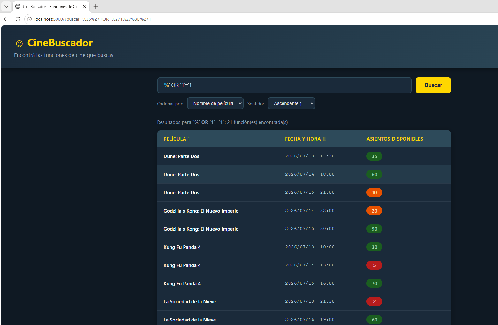

#### PoC 2 – UNION SELECT (inyección de fila arbitraria)

1. En el **campo de texto de búsqueda**, escribir exactamente el siguiente payload y presionar **Buscar**:

```
%' UNION SELECT 'INYECTADO','2099-01-01 00:00:00',999--
```

   El SQL resultante queda:
   ```sql
   WHERE peliculas.nombre LIKE '%%' UNION SELECT 'INYECTADO','2099-01-01 00:00:00',999--%'
   -- el ORDER BY queda comentado por --
   ```

2. **Resultado esperado:** la tabla muestra todas las películas (por el comodín `%%`) más una fila extra con película `INYECTADO`, fecha `2099-01-01` y asientos `999`.

> **Nota:** el payload no va en la URL sino escrito directamente en el campo de búsqueda. Inyectarlo vía el parámetro `sentido` (ORDER BY) falla en SQLite porque no permite ORDER BY antes de UNION.

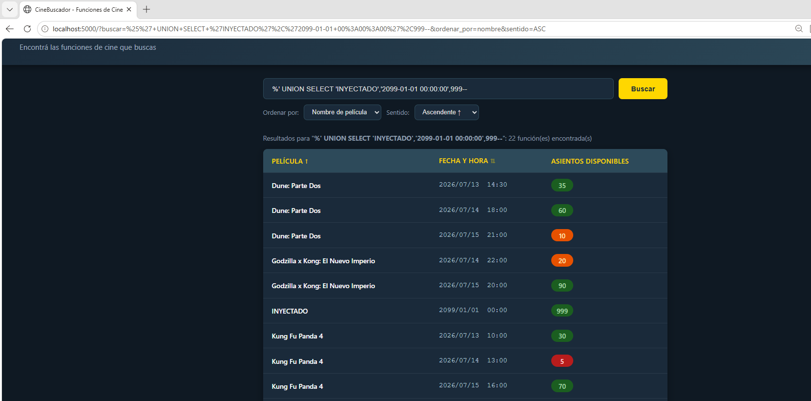

### Mitigación implementada

Se reemplazaron los f-strings por **consultas parametrizadas** usando el placeholder `?` de `sqlite3`. Para `sort_by` y `sort_dir` se implementó una **whitelist estricta**:

```python
SORT_BY_ALLOWED  = {'nombre': 'peliculas.nombre', 'fecha': 'funciones.fecha_hora'}
SORT_DIR_ALLOWED = {'ASC', 'DESC'}

col       = SORT_BY_ALLOWED.get(sort_by, 'peliculas.nombre')
direction = sort_dir if sort_dir in SORT_DIR_ALLOWED else 'ASC'

sql = (f"SELECT ... WHERE peliculas.nombre LIKE ? ORDER BY {col} {direction}")
return db.execute(sql, (f'%{query}%',)).fetchall()
```

### Validación post-mitigación

- La tautología devuelve 0 resultados.
- El `UNION SELECT` retorna error o 0 resultados — la fila inyectada no aparece.

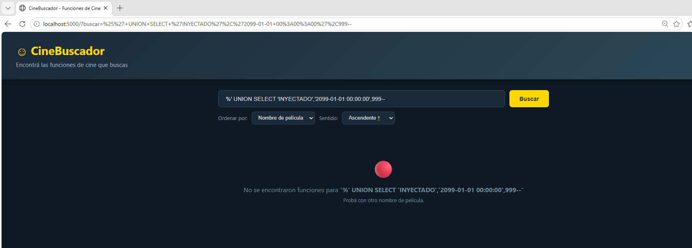

---

## Ejercicio 2 – Cross-Site Scripting (XSS)

### Vulnerabilidad identificada

**CWE-79 – Improper Neutralization of Input During Web Page Generation (Stored XSS)**

El template `Ejercicio2/templates/edit.html` usa el filtro `| safe` de Jinja2 al renderizar la descripción de la película, desactivando el escape automático de HTML:

```html
<!-- edit.html – línea 86 -->
{{ pelicula['descripcion'] | safe }}
```

El endpoint `POST /edit/<id>` guarda el campo `descripcion` sin sanitización. El resultado es un **XSS almacenado**: el payload se persiste en la BD y se ejecuta en el navegador de cualquier usuario que visite `/edit/<id>`.

### Prueba de Concepto (PoC)

**Entorno:** `http://localhost:5000` (levantar con `docker-compose up` en `Ejercicio2/`)

#### Paso 1 – Inyectar el payload

1. Buscar cualquier película y hacer clic en **Editar**.
2. En el campo **Descripción**, ingresar:

```html
<script>alert('XSS-STORED-EJ2')</script>
```

3. Hacer clic en **Guardar cambios**.

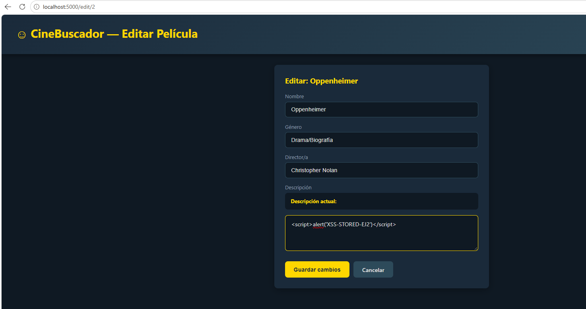

#### Paso 2 – Activar el XSS

4. Navegar a `/edit/1` (o el ID usado).
5. **Resultado esperado:** el navegador ejecuta el script y muestra el diálogo.

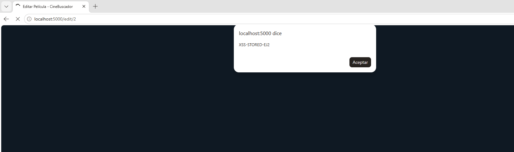

### Mitigación implementada

Se eliminó el filtro `| safe` de `edit.html`. Jinja2 escapa el HTML automáticamente por defecto:

```html
<!-- ANTES (vulnerable) -->
{{ pelicula['descripcion'] | safe }}

<!-- DESPUÉS (seguro) -->
{{ pelicula['descripcion'] }}
```

### Validación post-mitigación

- El payload se muestra como texto literal, sin ejecutarse.
- En el HTML fuente se observan las entidades escapadas: `&lt;script&gt;`.

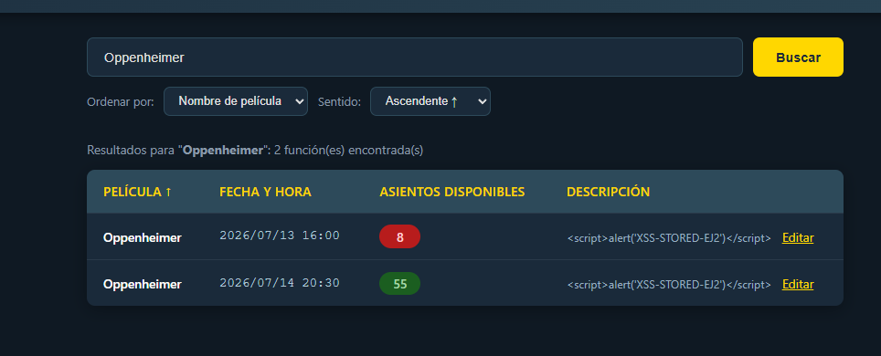

---

## Ejercicio 3 – File Upload

### Vulnerabilidad identificada

**CWE-434 – Unrestricted Upload of File with Dangerous Type**

El método `uploadFile()` en `PeliculaController.java` guarda el archivo usando el nombre original del cliente sin validar tipo, extensión ni sanitizar el nombre:

```java
// PeliculaController.java – líneas 88-93
String filename = archivo.getOriginalFilename();  // controlado por el atacante
Files.copy(archivo.getInputStream(), uploadPath.resolve(filename));
```

El endpoint `GET /uploads/{filename:.+}` sirve cualquier archivo de forma pública, incluyendo `.html` que el navegador interpreta como página web.

### Prueba de Concepto (PoC)

**Entorno:** `http://localhost:8080` (levantar con `docker-compose up` en `Ejercicio3/`)

#### Pasos

1. Crear un archivo local `xss.html`:

```html
<script>alert('XSS via CWE-434 File Upload')</script>
```

2. Buscar cualquier película en `http://localhost:8080` y hacer clic en **Subir afiche**.
3. Seleccionar `xss.html` y hacer clic en **Subir afiche**.

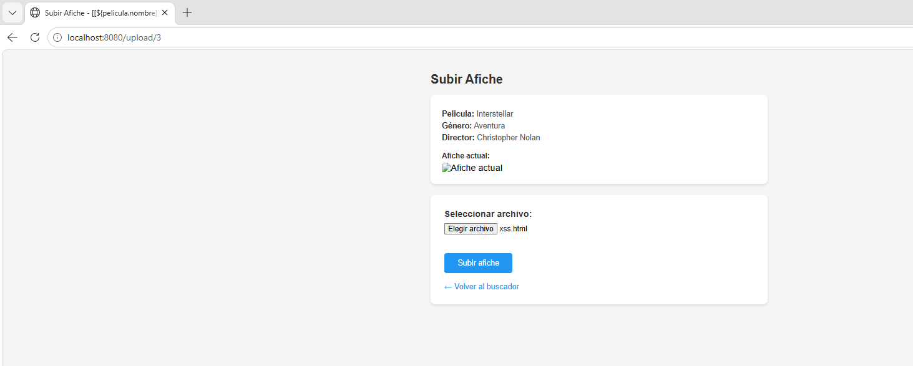

4. Navegar a `http://localhost:8080/uploads/xss.html`
5. **Resultado esperado:** el navegador ejecuta el script y muestra el diálogo.

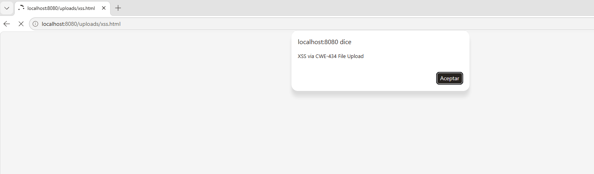

### Mitigación implementada

Se agregaron tres controles en `uploadFile()`:

1. **Whitelist de extensiones:** solo `.jpg`, `.jpeg`, `.png`, `.webp`, `.gif`.
2. **Nombre seguro con UUID:** se descarta `getOriginalFilename()`.
3. **Protección contra path traversal:** verificación de que la ruta resuelta permanece dentro del directorio de uploads.

```java
String ext = originalName.substring(originalName.lastIndexOf('.')).toLowerCase();
Set<String> ALLOWED = Set.of(".jpg", ".jpeg", ".png", ".webp", ".gif");
if (!ALLOWED.contains(ext)) {
    return "redirect:/?error=tipo_no_permitido";
}
String safeFilename = UUID.randomUUID().toString() + ext;
Path dest = uploadPath.resolve(safeFilename).normalize();
if (!dest.startsWith(uploadPath.normalize())) {
    return "redirect:/?error=path_invalido";
}
```

### Validación post-mitigación

- Subir `xss.html` devuelve error; el archivo no se guarda.
- Subir un `.jpg` legítimo funciona y se guarda con nombre UUID.

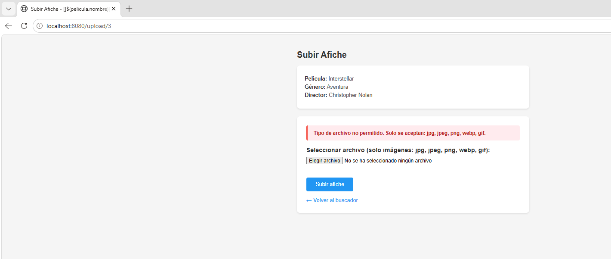

---

## Ejercicio 4 – Server Side Template Injection (SSTI)

### Vulnerabilidad identificada

**CWE-94 / CWE-917 – SpEL Injection (Spring Expression Language)**

`SpelEvaluator.java` evalúa el parámetro GET `buscar` directamente como expresión SpEL usando `StandardEvaluationContext`, el contexto sin restricciones. El contexto seguro (`SimpleEvaluationContext`) está instanciado pero nunca se usa:

```java
// SpelEvaluator.java – líneas 19-31
ExpressionParser parser = new SpelExpressionParser();
// SimpleEvaluationContext instanciado pero IGNORADO:
org.springframework.expression.EvaluationContext context =
    SimpleEvaluationContext.forReadOnlyDataBinding().build();
// Se usa el contexto SIN restricciones:
StandardEvaluationContext standardContext = new StandardEvaluationContext();
standardContext.setVariable("system",  System.class);
standardContext.setVariable("runtime", Runtime.class);
var expr   = parser.parseExpression(expression);
Object result = expr.getValue(standardContext);  // RCE posible
```

### Prueba de Concepto (PoC)

**Entorno:** `http://localhost:8080` (levantar con `docker-compose up` en `Ejercicio4/`)

#### PoC 1 – Expresión matemática (confirma evaluación de código)

Ingresar en el campo de búsqueda:

```
7*7
```

**Resultado esperado:** la aplicación muestra `49`, no el texto literal.

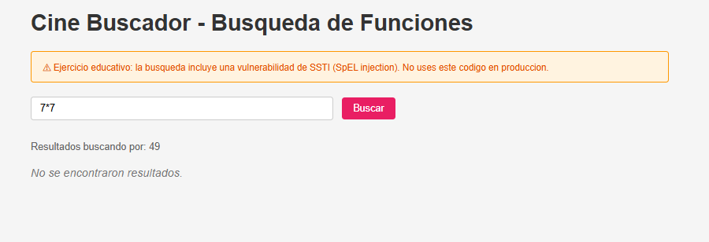

#### PoC 2 – Lectura de propiedad del sistema

```
T(java.lang.System).getProperty('user.home')
```

**Resultado esperado:** se muestra el directorio home del proceso (p. ej., `/root`).

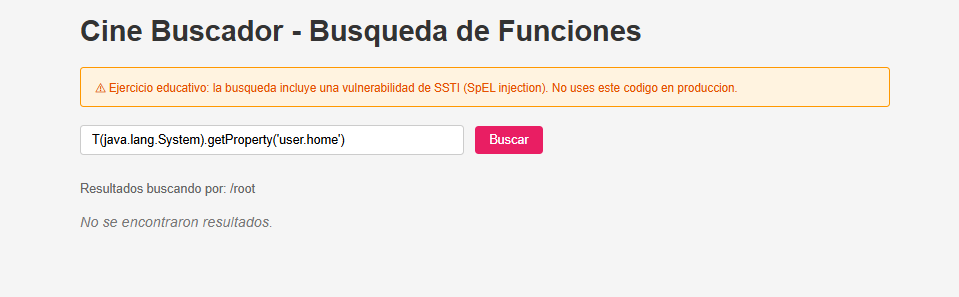

#### PoC 3 – Lectura de archivos críticos del sistema operativo

Debido a las restricciones de módulos de Java 17+ (que bloquean la lectura directa del stream de `ProcessImpl`), el payload más directo para demostrar el impacto crítico es leer archivos confidenciales del sistema:

```
T(java.nio.file.Files).readString(T(java.nio.file.Paths).get('/etc/passwd'))
```

**Resultado esperado:** se muestra el contenido completo del archivo `/etc/passwd` del servidor, exponiendo todos los usuarios del sistema.

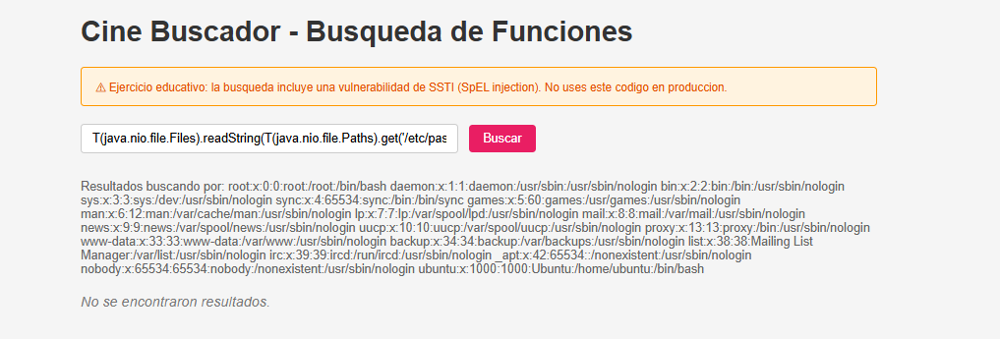

### Mitigación implementada

Se eliminó la evaluación SpEL del input del usuario. El campo `buscar` se usa directamente como string para filtrar resultados:

```java
// ANTES
String spelResultado = spelEval.evaluate(buscar);
// filtrado sobre spelResultado ...

// DESPUÉS: buscar se usa como filtro de texto simple
List<Funcion> resultados = funcionRepo.findAll().stream()
    .filter(f -> f.getNombreFuncion() != null &&
                 f.getNombreFuncion().toLowerCase().contains(buscar.toLowerCase()))
    .collect(Collectors.toList());
```

La clase `SpelEvaluator` fue removida del proyecto.

### Validación post-mitigación

- Ingresar `7*7` devuelve 0 resultados (búsqueda de texto literal).
- Ingresar la expresión RCE devuelve 0 resultados; ningún comando se ejecuta.

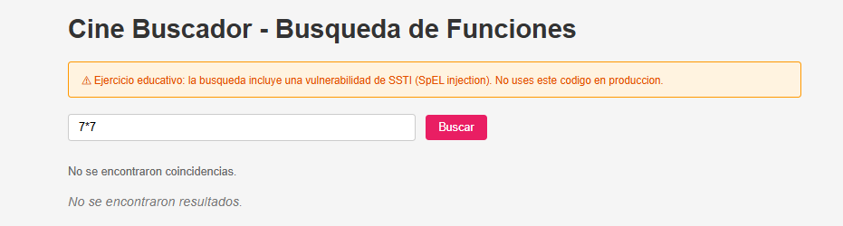

---

## Ejercicio 5 – Almacenamiento Inseguro

### Vulnerabilidad identificada

**CWE-257 / CWE-321 – Contraseñas en formato recuperable con clave embebida en código**

`EncryptionService.java` presenta tres fallas:

**1. Clave AES hardcodeada en el código fuente (línea 22):**

```java
private static final String SECRET_KEY = "MySup3rS3cr3tK3y!2024CineBuscadorAES";
```

**2. Modo ECB – determinístico (línea 43):**

```java
private static final String CIPHER_ALGO = "AES/ECB/PKCS5Padding";
```

Dos usuarios con la misma contraseña producen exactamente el mismo ciphertext.

**3. Cifrado reversible:** existe `EncryptionService.decrypt()`. Con la clave pública en GitHub, cualquiera descifra todas las contraseñas.

Además, `AuthController.java` línea 40 expone el ciphertext en la respuesta HTTP post-login.

### Prueba de Concepto (PoC)

**Entorno:** `http://localhost:8080` (levantar con `docker-compose up` en `Ejercicio5/`)

#### Paso 1 – Obtener el ciphertext desde la UI

1. Registrar un usuario nuevo (ej: `victima` / `mipassword123`).
2. Iniciar sesión con ese usuario. La aplicación mostrará en pantalla la contraseña cifrada en formato Base64.

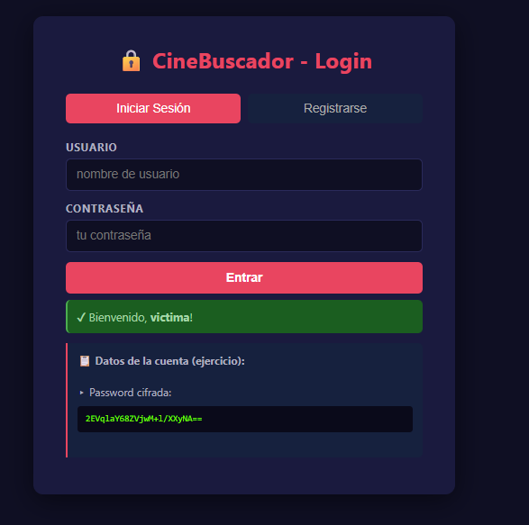

#### Paso 2 – Descifrar con la clave del código fuente

Con la clave obtenida del repositorio público, ejecutar en el entorno de laboratorio:

```python
from Crypto.Cipher import AES
import base64

key_bytes = "MySup3rS3cr3tK3y!2024CineBuscadorAES".encode('utf-8')[:32]
encrypted = base64.b64decode("2EVqlaY68ZVjwM+l/XXyNA==")
cipher     = AES.new(key_bytes, AES.MODE_ECB)
decrypted  = cipher.decrypt(encrypted)
pad_len    = decrypted[-1]
print(decrypted[:-pad_len].decode('utf-8'))  # imprime: mipassword123
```

**Resultado esperado:** el script imprime `mipassword123`.

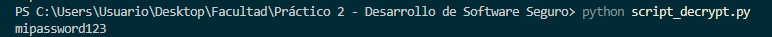


### Mitigación implementada

Se reemplazó el cifrado reversible por **BCrypt** (hashing con sal aleatoria, parte de Spring Security):

```java
// ANTES
nuevoUsuario.setPassword(EncryptionService.encrypt(password));

// DESPUÉS
BCryptPasswordEncoder encoder = new BCryptPasswordEncoder();
nuevoUsuario.setPassword(encoder.encode(password));
```

```java
// ANTES
String decryptedPassword = EncryptionService.decrypt(user.getPassword());
if (password.equals(decryptedPassword)) { ... }

// DESPUÉS
if (encoder.matches(password, user.getPassword())) { ... }
```

Adicionalmente:
- Se eliminó la clase `EncryptionService` completa.
- Se eliminó la exposición del hash en la UI (`encryptedPassword` del modelo).

### Validación post-mitigación

- La contraseña almacenada tiene formato BCrypt (`$2a$10$...`), irreversible.
- El script Python de descifrado no puede recuperar la contraseña.
- Dos usuarios con la misma contraseña tienen hashes **diferentes** (sal aleatoria).
- La UI post-login no muestra ningún valor de contraseña.

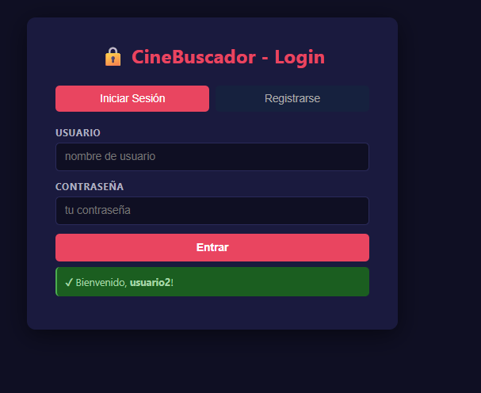

---

*Informe generado en la rama `practico-2` del repositorio https://github.com/MateoC4BR4L/2026-Desarrollo-Seguro*
